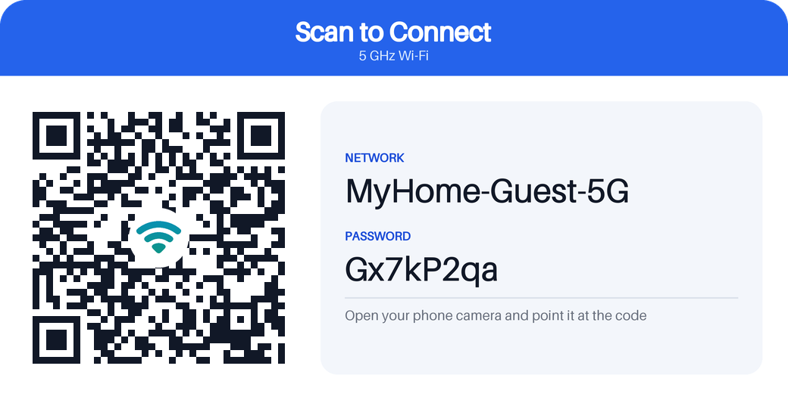

# TP-Link Router Care

A Home Assistant custom integration for TP-Link routers, built on
[`tplinkrouterc6u`](https://github.com/AlexandrErohin/TP-Link-Archer-C6U).
It also comes with a standalone script for testing the connection.

## 1. Test connectivity first (no Home Assistant needed)

```bash
python3 -m venv .venv
.venv/bin/pip install -r test_app/requirements.txt
.venv/bin/python test_app/test_connection.py 192.168.0.1          # prompts for password
.venv/bin/python test_app/test_connection.py 192.168.0.1 --debug  # verbose library logs
```

The script checks that the router's port is reachable, detects the model, logs in, and prints
the firmware, status and connected devices. If it passes, the integration will work with the
same IP and password.

> Log out of the router's web UI first. Most TP-Link routers allow only one admin session.

### Change the guest 5 GHz password from the command line

```bash
.venv/bin/python test_app/set_guest_password.py 192.168.0.1                # random 8-char password
.venv/bin/python test_app/set_guest_password.py 192.168.0.1 MyNewPass123   # specific password
.venv/bin/python test_app/set_guest_password.py 192.168.0.1 --client TplinkRouter  # skip model detection
```

It uses the same logic as the integration's **New guest 5 GHz password** button. It shows the
current password, writes the new one to the shared 2.4 + 5 GHz guest form (falling back to the
5 GHz form on routers without one), then reads both forms back to confirm the router applied it.

## 2. Install the integration

### With HACS (recommended)

1. In Home Assistant, open **HACS**, click the **⋮** menu (top right) and choose **Custom
   repositories**.
2. Add `https://github.com/dpkprojects/tplink_router_care` with type **Integration**.
3. Search HACS for **TP-Link Router Care**, open it and click **Download**.
4. Restart Home Assistant.

HACS will then offer updates whenever a new release is published.

### Manually

Copy `custom_components/tplink_router_care` into your Home Assistant `config/custom_components/`
folder and restart Home Assistant.

### Set it up

Go to **Settings → Devices & Services → Add Integration →
TP-Link Router Care** and enter:

| Field | Notes |
|---|---|
| Router IP address | e.g. `192.168.0.1`. Use `https://192.168.0.1` if the router only serves HTTPS. |
| Router password | The web UI password. |
| Username | Optional, defaults to `admin`. |

The first setup can take up to a couple of minutes, because the library tries each router model
in turn. The model it finds is saved, so later polls skip this step.

## Entities

- **Router reachable** (connectivity binary sensor). Turns off when a poll fails.
- **Last sync** (timestamp sensor). When data was last read from the router successfully, shown as
  "5 minutes ago". It keeps showing the last good time while the router is unreachable.
- **Connected / Wi-Fi / Wired / Guest clients** sensors.
- **CPU usage, Memory usage, WAN IP address, WAN uptime** (diagnostic). These are created only if
  your router reports them.
- **Refresh data** button. Polls the router immediately, for when you want fresh metrics without
  waiting for the next scheduled poll (or when automatic polling is disabled).
- **Restart** button.
- **Guest Wi-Fi 5 GHz** switch. Turns the 5 GHz guest network on and off.
- **New guest 5 GHz password** button. Sets a random 8-character password (letters and digits) on
  the 5 GHz guest network. On routers where 2.4 and 5 GHz guest share one password (e.g. Archer
  AXE75), the 2.4 GHz guest password changes too; the router doesn't allow setting them separately.
- **Guest 5 GHz password** and **Guest 5 GHz SSID** sensors. Show the current guest password and
  network name, so you can read them off the device page.
- **Guest 5 GHz QR code** image. A Wi-Fi card with a scannable QR code plus the network name and
  password, generated in memory from what the router reports. It updates automatically when the
  password changes, and guests can join by pointing their phone camera at it. Choose a **Light**
  or **Dark** card under **Settings → Devices & Services → TP-Link Router Care → Configure**; the
  change applies immediately.

  

  *Sample card with a dummy network name and password.*

  **Get the card over HTTP (webhook).** The same PNG can be served at a webhook URL, so a wall
  tablet, e-ink display, kiosk page or script can fetch it without a Home Assistant token. It's
  off by default. To set it up, open **Settings → Devices & Services → TP-Link Router Care →
  Configure**:

  - **Enable QR code webhook** turns it on or off.
  - **Webhook ID** is the last part of the URL. It starts as a random ID. You can replace it
    with your own fixed ID (letters, digits, `-` and `_`, up to 64 characters), or clear the
    field to get a new random one.

  Changes apply immediately, with no restart and no router login. The ID stays the same across
  restarts and updates until you change it. The full URL is shown at the top of the same dialog:

  ```bash
  curl -o guest-wifi.png "http://homeassistant.local:8123/api/webhook/<webhook_id>"
  curl -o guest-wifi.png "http://homeassistant.local:8123/api/webhook/<webhook_id>?theme=dark"
  ```

  `GET` returns `image/png`. Use `?theme=light|dark` to override the configured theme. You get
  `404` if the router has no 5 GHz guest network, and `503` if the name or password isn't known
  yet. The webhook only answers requests from your local network, because the card shows the guest
  password. Anyone on your network who knows the ID can see the password, so pick one that's hard
  to guess.

The guest entities are created only if the router exposes the `guest_5g` wireless form (Archer
AXE75 / AXE5400 and similar). Password changes are read back from the router before they're
shown, so the sensor always reflects what the router actually stored.

By default the integration polls once an hour. Each poll logs in, reads the data and logs out.
Change this under **Settings → Devices & Services → TP-Link Router Care → Configure → Polling
interval**: every 30 minutes, 1, 3, 6, 12 or 24 hours, once a week, or **Disabled**. With polling
disabled, data is fetched once at startup and then only when you press **Refresh data**; guest
Wi-Fi changes made from Home Assistant still update their entities right away. The new interval
applies immediately, without a restart.

## How it avoids breaking Home Assistant

- `tplinkrouterc6u` is synchronous (it uses `requests`). Every call runs in HA's executor through
  `hass.async_add_executor_job`, never on the event loop.
- Every network operation has a timeout: 10 s per HTTP request, 45 s per poll, 180 s for model
  detection, and a 5 s TCP pre-check, so a wrong IP fails in seconds instead of minutes.
- A lock serializes access, so a poll and a reboot never fight over the single router session.
- If the router is offline at startup, the entry goes into *retry* mode in the background instead
  of failing. Unexpected library exceptions are caught and reported as failed updates.
- If the password is wrong, polling stops and HA asks you to re-enter it, so it won't keep
  failing logins and get you locked out of the router.
